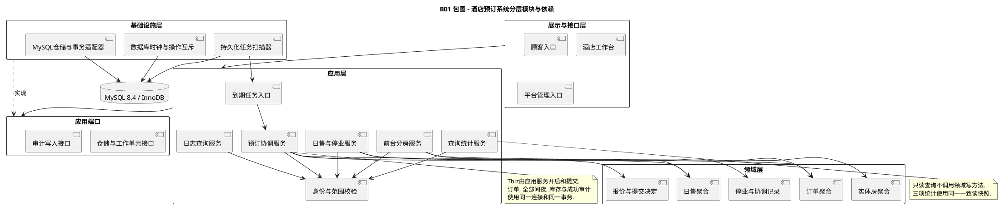
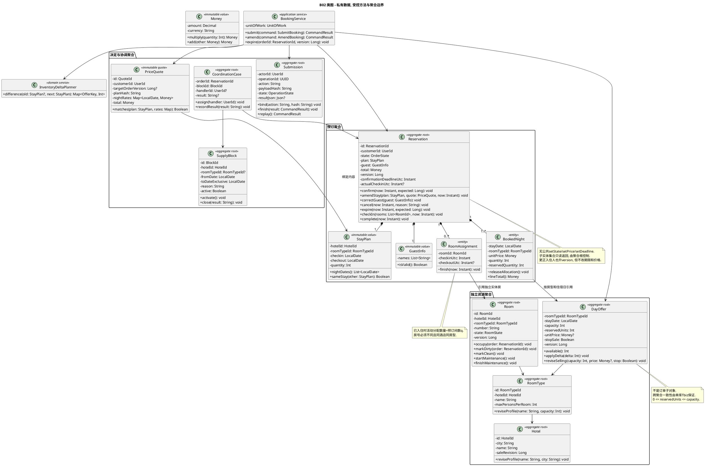
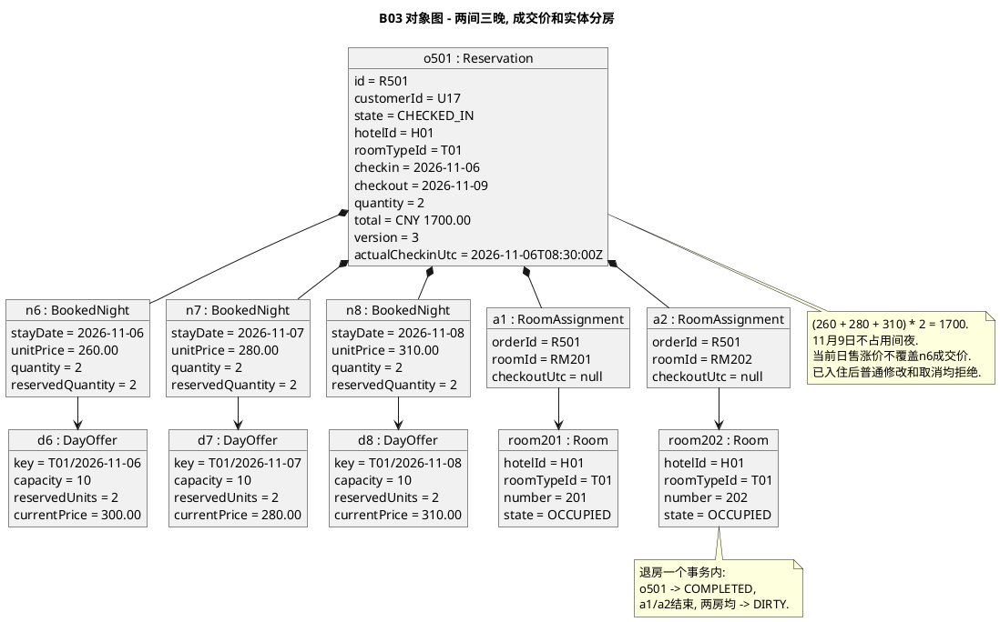
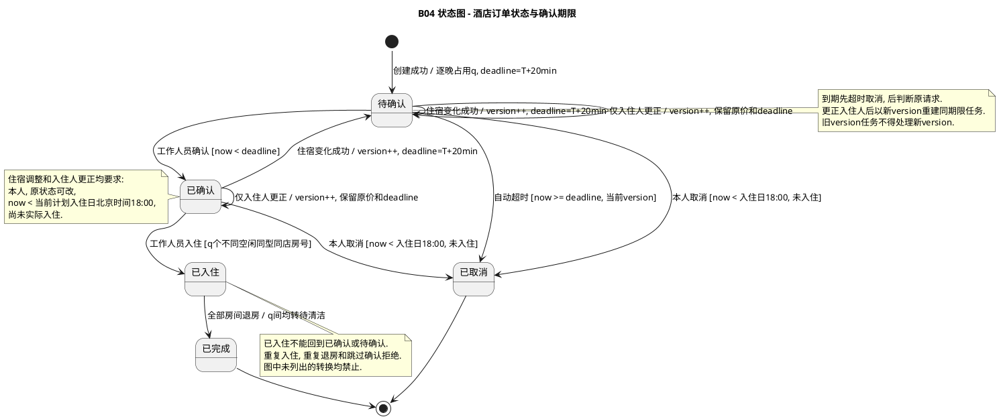
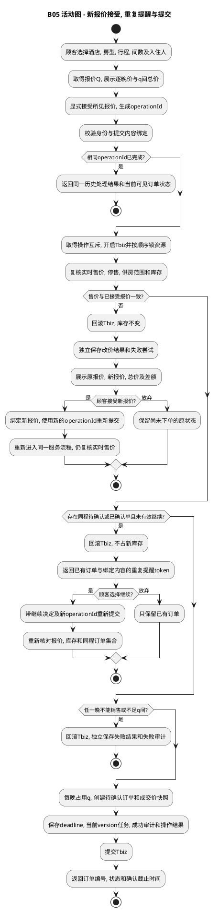
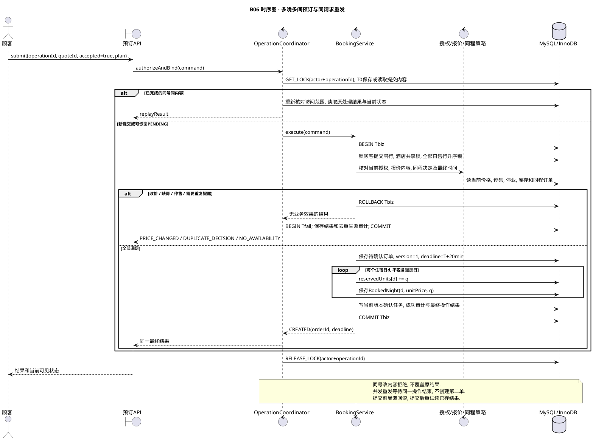
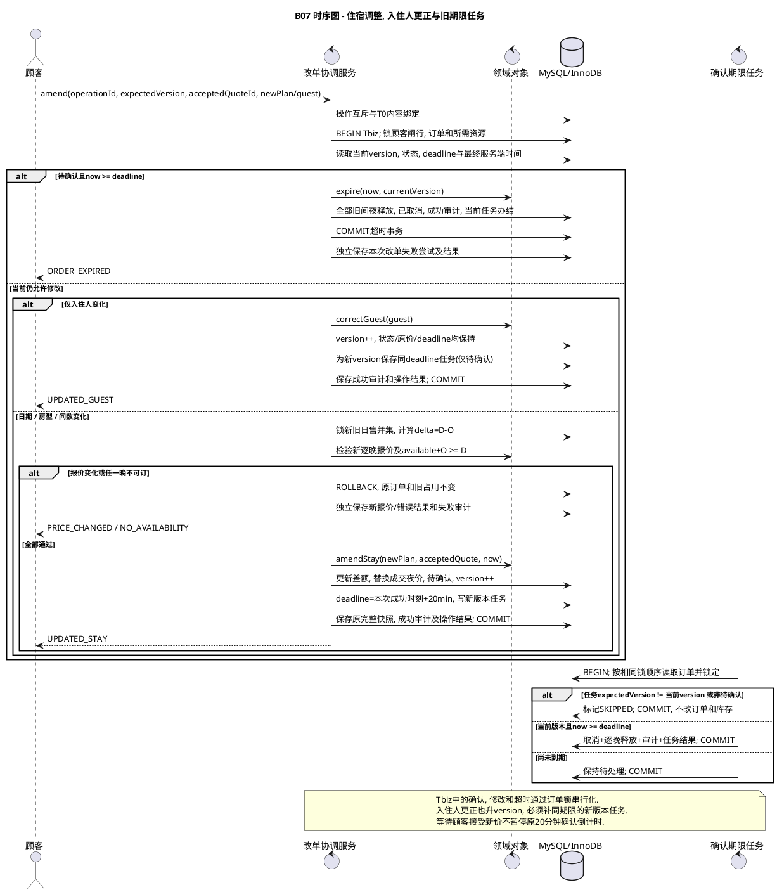
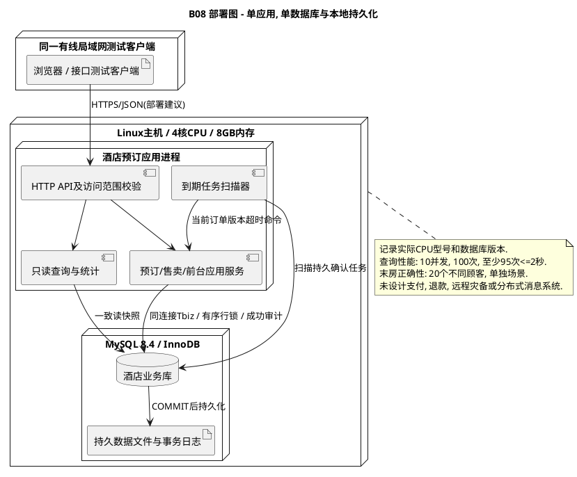

# 酒店预订系统原始设计提案

本提案只以本次输入的酒店预订系统26条已确认需求和实验二任务为基线. 内容为首次设计生成结果, 尚未经过设计负责人的人工审查或修订. 本次不实现软件和UI, 不新增支付, 退款, 会员, 营销或其他项目规则. 下文的测试均为后续验收设计, 不表示已经执行. UI编号为建议占位编号, 后续须与实际界面编号对齐.

## 1. 系统功能和角色

系统围绕房型逐日售卖, 多间多晚预订, 入住前调整, 酒店确认, 实体房分配和经营统计工作. 预订对象是房型在每个住宿夜晚的q间名额, 到店后才分配q个实体房号. 房型日售库存与实体客房当前状态分别管理, 不将二者混成同一个状态字段.

| 角色 | 主要功能 | 数据边界 |
| --- | --- | --- |
| 顾客 | 组合查房, 查看和接受报价, 提交预订, 处理同程提醒, 查看本人订单, 按规则改单或免费取消 | 只访问本人订单和提交记录 |
| 酒店工作人员 | 维护授权酒店的房型, 日售, 价格和停售, 确认订单, 分配客房, 入住, 退房, 清洁及停业协调 | 每次检查酒店管理授权; 查看日志还须具备该酒店独立的日志查看授权 |
| 平台管理员 | 酒店和用户管理, 人员授权, 平台异常处理, 管理列表, 平台统计和日志查询 | 具有平台管理范围; 不据此增加任意越过订单状态和期限的强制改单或取消能力 |

不预设三种角色必须互斥, 也不默认某角色自动继承另一个角色的业务权限. 账号可获得哪些角色由授权数据表达, 受保护入口分别核对角色和数据范围. 人员权限变更日志只给平台管理员, 即使工作人员拥有本酒店日志权限也不例外.

## 2. 设计选择与明确假设

以下内容是为课程原型选择的实现方案或待确认细节, 不把它们写成新增的已确认业务承诺.

| 编号 | 设计选择或假设 | 理由与确认边界 |
| --- | --- | --- |
| DA-01 | 采用分层单体, REST/JSON接口, MySQL 8.4/InnoDB和同库持久化任务 | 多晚库存与订单可使用本地事务, 不引入分布式事务或外部消息中间件 |
| DA-02 | 金额按CNY和两位小数设计; 查询价格范围暂建议解释为所选q间整个住宿行程总价 | 基线使用元计价但未明确价格筛选口径, 0元价格是否合法和金额上限也需确认; 数据层能表示非负金额, 发布规则不得擅自宣称已确认0元售卖 |
| DA-03 | 房型保存每间建议最大入住人数, 人数筛选暂按人数<=q乘每间容量 | 基线要求人数查询但未给出多间时的具体匹配算法; 入住人信息只要求有效, 不增加证件, 年龄或每间必须一位入住人的限制 |
| DA-04 | 日售库存是可售配额, 不自动等于当前空闲实体房数; 维修影响通过明确的酒店/房型日期范围阻止新预订 | 精细到维修几间就自动扣几间的策略未确认, 初稿不擅自推导; 房间维修结束暂建议转待清洁再恢复空闲, 具体维修状态转换待确认 |
| DA-05 | 当前改单示例和建议UI以同酒店改房型为范围 | 基线未明确是否允许跨酒店改订; 领域差额算法保留多个酒店键的表达能力, 不能据此声称跨酒店改订已经确认或可直接上线 |
| DA-06 | 工作人员记录联系与协调结果, 实际普通改单和取消仍由顾客本人按现有权限提交 | 基线未确认前台代顾客操作的授权协议; 协调不能绕过18:00或实际入住截止 |
| DA-07 | 使用服务器保存的不可变报价和决定token, 同一用户的operationId跨写操作唯一 | 这是内容绑定和重放协议的实现选择; 新接受价格或补充继续决定都会改变提交内容, 因而使用新operationId |
| DA-08 | 使用数据库时钟, 操作级命名锁, 有序行锁, 只读一致快照和任务表 | 属于单应用单库原型的并发方案, 不承诺未经测量的吞吐量和故障恢复时限 |

不增加固定14:00才能入住, 不增加最短或最长连住天数. 18:00是普通修改和取消截止, 不能直接推导为入住办理截止. 人数口径, 价格筛选口径, 跨酒店改订和维修细分策略应在编码前确认, 不影响下文对已确认时间, 状态和原子性规则的表达.

## 3. 分层架构与事务职责

采用展示接口层, 应用层, 领域层, 应用端口及基础设施适配器. 图B01表达依赖, 图B08表达部署. 展示层只组织输入和结果, 不直接更新库存或订单状态. 领域层保存不变量和受控方法, 不依赖HTTP或数据库驱动. 应用服务决定锁顺序, 聚合协作和事务开始结束, MySQL适配器实现仓储及工作单元.

| 模块 | 职责 | 主要协作 |
| --- | --- | --- |
| AccessScope | 身份, 角色, 本人归属, 酒店管理和日志查看授权 | 所有受保护入口; 每次查询有效授权, 不把页面可见性当作授权 |
| SellingService | 房型, 日售, 价格, 库存和停售维护, 停业范围 | DayOffer, SupplyBlock, 审计 |
| SearchQuoteService | 整段查询, 不锁库报价, 新旧价格差额 | 日售只读模型, PriceQuote |
| BookingService | 下单, 同程提醒, 住宿修改, 入住人更正, 取消和酒店确认 | Reservation, DayOffer, Submission, 超时任务 |
| FrontDeskService | q间分房, 入住, 全部房间退房和清洁 | Reservation, Room, RoomAssignment |
| ExceptionService | 已有受影响订单清单, 联系原因, 处理人员和结果 | SupplyBlock, CoordinationCase, 现有改单/取消入口 |
| ReportingService | 当前入住日管理列表, 订单数, 取消数和有效间夜 | 授权只读查询, 一致数据快照 |
| AuditService | 同事务成功日志, 独立失败尝试, 授权日志查询 | 业务事务, operationId, 酒店范围 |
| ConfirmationWorker | 扫描到期任务, 按当前版本取消待确认单 | 与普通取消共用逐晚释放规则 |

事务分为三类. T0短事务只持久化提交内容绑定和待处理状态, 不占库存. Tbiz由对应应用服务开启, 把订单, 全部相关日售, 成交夜价, 实体分房, 当前版本任务, 成功审计和最终操作结果一次提交. Tfail在Tbiz已回滚或业务校验拒绝后独立保存失败尝试及该提交的最终结果. 同一业务不会拆成先提交订单再另扣库存, 也不会先释放旧行程再尝试创建新行程.

停业范围的生效和成功审计属于一个事务. 已有订单不在该事务中批量改状态. 异常清单按生效停业范围与订单当前住宿日期交叠直接查询, 再关联协调处理记录. 即使处理记录尚未创建, 受影响订单也能出现在清单中, 避免依赖异步补表才发现旧单.

## 4. 时间, 状态与领域封装规则

### 4.1 时间和版本

DR-01: 住宿日期使用北京时间Asia/Shanghai的DATE, 对外明确为UTC+8. 订单起止区间为[checkinDate, checkoutDate), 退房日不占间夜. 业务时间点使用UTC Instant, 数据库用DATETIME(6)按UTC写入并固定连接时区, 页面和日志日期筛选转换为北京时间. 不能把UTC日期直接当作住宿自然日.

DR-02: 订单成功时保存业务成功时刻T和confirmationDeadlineUtc=T+20分钟. T取锁定资源后, 即将写入业务变更时的数据库时间, 不使用客户端点击时间或请求到达时间. 确认须在now<deadline, now>=deadline且仍待确认时执行超时取消, 恰到20分钟也算到期. 已确认订单不会因旧期限到达而取消.

普通修改和取消使用当前计划入住日北京时间18:00转换出的UTC时刻, 且必须尚未实际入住. 语义为早于18:00与实际入住中的较早截止点. 已入住状态与actualCheckinUtc均参与保护, 不能因为前台提前入住而继续按18:00放行.

DR-03: Reservation.version在每次实际订单修改时递增, 接口要求expectedVersion. 住宿日期, 房型或间数实际变化成功时转待确认并重新设置20分钟期限. 只改入住人也递增version, 但原状态, 原成交价格和原确认截止时间保持不变. 完全相同的住宿内容建议作为无变化结果返回, 不借此重新延长确认期.

每份确认任务携带orderId, expectedVersion, deadline. 入住人更正后如订单仍待确认, 同事务创建新version对应的任务, 期限仍是旧期限. 旧任务版本不符直接跳过, 新任务继续在原期限触发. 另有按(status, confirmationDeadlineUtc)扫描当前订单的兜底入口, 防止历史任务跳过后遗漏超时. 已过期待确认单进入确认或改单流程时先完成当前版本超时取消, 再拒绝原操作. 该超时取消有独立的系统operationId和成功审计, 不伪装为顾客改单成功.

### 4.2 状态与聚合

DR-04: 订单只有待确认, 已确认, 已入住, 已完成, 已取消五种业务状态. 合法转换为待确认->已确认/已取消, 已确认->已入住/已取消, 已入住->已完成; 入住前住宿变化可使待确认保持待确认或已确认回到待确认. 已完成和已取消为终态. 只改入住人不产生状态转换. 图B04给出允许边和保护条件, 未列出的状态跳转拒绝.

图B02中的字段均为私有字段, 不提供setState, setTotal, setDeadline或可任意替换子集合的公共接口. 仓储只在应用事务内加载和保存聚合; 外部取得不可变值对象或只读视图. Reservation负责本人行程, 状态, 期限, 成交价和分房子记录, DayOffer负责单房型单日期的可售配额, Room负责实体客房当前状态. 跨聚合联动由应用服务在同一Tbiz内完成, 不把数据库外键当作全部领域规则.

BookedNight和RoomAssignment归Reservation组合所有, 不独立开放写接口. Hotel, RoomType, DayOffer和Room是独立资源聚合, 订单通过编号引用. PriceQuote不可变, GuestInfo和StayPlan为不可变值对象. InventoryDeltaPlanner只计算新旧占用差额, 不自行提交数据库.

## 5. 多晚多间库存与实体房事务

### 5.1 日售占用和改单

DR-05: 每个住宿日期d均有一条DayOffer(roomTypeId,d). 设容量C[d], 已占用R[d], 余量A[d]=C[d]-R[d], 始终保持0<=R[d]<=C[d]. 缺少日售或售价, 停售, 生效停业范围覆盖任一晚, 或任一晚不足所需间数, 都不能新下单. 全程可售数量=min(A[d]), 总价=q乘各晚单价之和. 三晚余量4,2,3和价格260,280,310时最多可订2间, 2间总价1700元. 未选q时可先展示明确标为单间全程参考价的结果, 不把参考值当作顾客已接受的下单间数.

首次下单每晚新增q间占用. 待确认已经占用库存, 酒店确认不再扣一次. 成交夜价单独保存, 后续调整日售价不改已成交记录. 未取消订单的历史间夜占用保留在对应住宿日期, 退房不把已完成订单的过去日期改成未预订; 物理房状态与日期配额分别变化.

改单先从旧订单保存的间夜构造O[(type,date)], 从新行程构造D[(type,date)], 对并集计算delta=D-O. 同房型重叠日期只写差额; 新需求判断使用A+O>=D, 不能拿扣除了本人旧占用的余量直接和D比较. 新行程仍逐晚检查最新价格, 售卖和停业条件. 改房型的旧键释放和新键占用仍在一个事务. 全段新行程重新保存顾客接受的成交夜价, 包括重叠日期; 旧行程和旧夜价完整进入审计快照.

例如2间的11月6日至9日改为7日至10日, 6日delta=-2, 7日和8日delta=0, 9日delta=+2. 9日只能增加1间时整单失败, 原订单, 原价格, 原占用和原期限保持原样. 用户等待接受新报价期间不释放旧房也不占新房; 原待确认订单自身的20分钟倒计时仍正常运行, 不能用报价等待延长期限.

取消锁定当前有效间夜, 将每晚reservedQuantity从q变0, 对日售R逐晚减q, 同时改已取消并提交审计. 已经为0的间夜不得再次减库存. 重放成功取消返回原结果, 新operationId重复取消返回状态冲突但不再释放.

### 5.2 锁顺序与销售变化

DR-06: 所有写命令使用同一全局资源顺序: 操作级互斥, 有效授权检查, 顾客提交闸行, 订单行按编号, 酒店行按编号, 日售行按(hotelId,roomTypeId,stayDate), 实体房行按roomId, 最后写子记录与审计. 只锁本次需要的资源. 超时, 确认, 改单和取消遵守相同顺序. 同顾客的订单写操作使用customer_booking_guard串行, 避免两个不同新请求同时绕过同程提醒; 不同顾客仍可并发竞争末房.

预订在相关酒店行持共享锁, 售价, 配额, 停售和停业维护持排他锁, 再按日售键锁定行. 酒店停售生效与并发新预订因此具有明确先后顺序. 日售行通过唯一键定位并用SELECT FOR UPDATE读取当前值, 不用事务开始前的缓存余量执行扣减. 不存在的日期不临时补默认价格或库存, 直接视为不可订.

死锁或数据库瞬时冲突只允许以相同operationId重试完整Tbiz, 不保留半程变化. 重试次数和锁等待时限为技术配置, 不能把冲突伪装为成功. 不声称加锁方案消除了所有数据库死锁, 正确性依赖回滚与同提交重试协议.

### 5.3 q间分房和退房

DR-07: 入住事务锁订单, 重新检查已确认和酒店授权, 校验提交房号数量恰为q, 去重后仍为q, 再按roomId升序锁全部房间. 每个房号必须属于订单酒店与房型, 当前为空闲且无其他活动分配. 全部通过后写q条活动RoomAssignment, 将q个Room转已入住, 订单转已入住并记录actualCheckinUtc, 成功审计同事务提交. 任一房间失败则所有分配和状态均回滚.

退房锁同一订单及其全部活动分配对应的房间, 在一个事务中将订单转已完成, 所有分配写checkoutUtc, q个房间全部转待清洁. 清洁完成才允许Room.markClean转空闲. 重复入住, 重复退房, 已入住/维修/待清洁房参与分房均拒绝. 不增加部分入住, 部分退房或拆单规则. 图B03展示2间3晚实例, 其中已成交260元的一晚不受当前日售价300元影响.

### 5.4 停业维修和旧单协调

DR-08: SupplyBlock记录受影响酒店或房型, 北京时间起止日期, 原因, 生效状态和创建人. 界面输入的含尾日范围统一转换为内部[开始日, 结束日次日). 新预订和住宿调整对目标全程复核受影响范围, 旧页面不能绕过. 仅入住人更正不重新购买库存, 不因停售而自动取消原订单.

异常清单从当前行程与SupplyBlock交叠生成, 保留旧订单. CoordinationCase以(blockId,orderId)唯一记录处理人, 联系记录和最终结果, 不直接改订单状态. 完成改期或取消仍调用原订单规则, 失败和超过截止均不自动绕过. 停业解除不恢复已取消订单, 不删除历史原因和处理结果.

## 6. 报价接受, 同程提醒和提交标识协议

DR-09: 报价Q保存quoteId, customerId, 操作目的NEW/AMEND, 目标orderId及expectedVersion, 酒店和房型, 入退日期, q, 各晚单价, 总价和内容摘要. 报价不锁库存也不保价, 不另创一个已确认的报价有效期. 服务端保存不可变报价内容, 客户端不能自行拼接更低夜价或更换行程沿用quoteId.

提交必须携带acceptedQuoteId和显式acceptPrice=true. 服务端在锁定当前资源后逐晚比较实际价格和已接受报价, 同时核对报价所属人和完整行程. 只有库存版本变化而实际价格未变时可在重新检查余量后继续, 不因为无关版本变化无条件要求重新接受. 价格变化则不写业务占用, 返回PRICE_CHANGED, 替代报价和逐晚差异.

新下单展示previousQuotedTotal, newQuotedTotal和deltaVsQuote. 改住宿同时展示currentOrderTotal, previousQuotedTotal, newQuotedTotal, deltaVsOrder和deltaVsQuote, 区分原订单金额与上次所见新行程报价. 顾客放弃保留原状态, 接受替代报价必须用新operationId. 再次变价再次展示并征询, 不静默按新价成交.

DR-10: 新请求在当前顾客待确认或已确认订单中比较hotelId,roomTypeId,checkinDate,checkoutDate,q五项, 全相同才提示可能重复. 入住人不参与比较, 不同入住人仍提醒. 已入住, 已完成和已取消排除. 同operationId重发先按重放处理, 不当作新的同程订单.

提醒返回已有订单编号和行程, 以及绑定顾客, 新行程, 报价和当前匹配订单集合的decisionToken. 放弃不创建新单. 继续时使用新operationId并携带continueDuplicate=true与该token, 仍重查实时售价和库存. 若匹配集合新增了顾客尚未确认的同程订单, 返回新提醒; 匹配集合已为空则无需重复提醒. 同顾客提交闸行使比较与新单提交具有一致的先后关系.

DR-11: 所有写命令统一使用(actorId,operationId), canonicalPayloadHash绑定动作, 目标, expectedVersion, 报价和决定内容. 同号同内容读取同一最终结果; 同号改动作或改参数拒绝, 不覆盖原提交. 接受新价格或补充继续决定是新内容, 须使用新号. 保存期间不主动复用已用号是本原型的持久化选择, 不改变业务状态规则.

OperationCoordinator先核对身份和可见范围, 使用专用数据库连接取得按(actorId,operationId)计算的GET_LOCK命名锁, T0保存PENDING内容绑定. 命名锁跨越Tbiz回滚和Tfail提交, 防止首请求失败尚未写结果时并发重发抢先执行. 完成结果与业务成功同事务写入; 失败则在独立Tfail中写失败结果及去重失败审计. 连接释放或进程退出释放命名锁. 恢复时仍为PENDING且无成功结果的操作可按原内容重新执行, 因为已提交业务必定同时保存最终操作结果.

并发重发等待同一操作结束后读取结果; 如果传输层等待超时, 可返回202和同一operationId供轮询, 这只表示处理中, 不表示另一次预订成功. 取得最终结果后所有重发仍指向同一订单. 回放历史成功结果时同时展示当前可见订单状态, 不恢复后来已取消的订单, 当前权限被撤销时不泄露旧结果.

## 7. 数据库设计

业务编号使用BIGINT UNSIGNED代理键并给对外编号加唯一约束; operationId使用BINARY(16)存UUID. 日期使用DATE, 时刻字段后缀统一Utc并使用DATETIME(6), 连接会话使用UTC. 单价建议DECIMAL(12,2), 订单总价建议DECIMAL(16,2), 不使用浮点金额. 枚举字段采用VARCHAR加CHECK或等效受控映射. 这些精度是原型存储选择, 超出范围返回校验错误, 不静默截断或四舍五入成交.

| 表 | 关键字段和类型 | 约束与索引 |
| --- | --- | --- |
| app_user | id BIGINT, account VARCHAR, password_hash VARCHAR, enabled BOOLEAN, auth_version BIGINT | PK(id), UNIQUE(account); 不保存明文密码, 账号识别与登录形式为实现细节 |
| user_role | user_id BIGINT, role VARCHAR | PK(user_id,role), FK user; 不预设互斥 |
| hotel_grant | user_id BIGINT, hotel_id BIGINT, capability VARCHAR, active BOOLEAN, version BIGINT | PK(user_id,hotel_id,capability); capability区分MANAGE_HOTEL与VIEW_OPERATION_LOG, 日志访问检查二者有效范围交集 |
| hotel | id BIGINT, public_no VARCHAR, name VARCHAR, city VARCHAR, sale_revision BIGINT | UNIQUE(public_no), INDEX(city,id); 酒店行兼作销售策略共享/排他锁定点 |
| room_type | id BIGINT, hotel_id BIGINT, public_no VARCHAR, name VARCHAR, max_persons INT, version BIGINT | UNIQUE(public_no), UNIQUE(id,hotel_id), INDEX(hotel_id,id); max_persons算法见DA-03 |
| day_offer | room_type_id BIGINT, stay_date DATE, capacity INT, reserved_units INT, unit_price DECIMAL(12,2) NULL, stop_sale BOOLEAN, version BIGINT | PK(room_type_id,stay_date), CHECK(0<=reserved_units AND reserved_units<=capacity), CHECK(capacity>=0); 缺价用NULL表达, 有价时不得为负 |
| reservation | id BIGINT, public_no VARCHAR, customer_id BIGINT, hotel_id BIGINT, room_type_id BIGINT, checkin_date DATE, checkout_date DATE, quantity INT, guest_json JSON, status VARCHAR, total DECIMAL(16,2), currency CHAR(3), version BIGINT, created_utc DATETIME(6), wait_started_utc DATETIME(6), confirmation_deadline_utc DATETIME(6), actual_checkin_utc DATETIME(6) NULL, completed_utc DATETIME(6) NULL, cancelled_utc DATETIME(6) NULL | UNIQUE(public_no), CHECK(quantity>0 AND checkin_date<checkout_date), 复合FK(room_type_id,hotel_id); INDEX(customer_id,status,hotel_id,room_type_id,checkin_date,checkout_date,quantity), INDEX(hotel_id,checkin_date,status), INDEX(status,confirmation_deadline_utc) |
| reservation_night | reservation_id BIGINT, stay_date DATE, room_type_id BIGINT, unit_price DECIMAL(12,2), quantity INT, reserved_quantity INT | PK(reservation_id,stay_date), FK reservation, FK(room_type_id,stay_date)引用day_offer; reserved_quantity取0或quantity, INDEX(room_type_id,stay_date,reserved_quantity); 聚合保存时核对全部夜晚与父行程一致 |
| confirmation_job | reservation_id BIGINT, expected_version BIGINT, deadline_utc DATETIME(6), state VARCHAR, result VARCHAR NULL | PK(reservation_id,expected_version), INDEX(state,deadline_utc); 与当前版本订单同事务建立 |
| room | id BIGINT, hotel_id BIGINT, room_type_id BIGINT, room_number VARCHAR, status VARCHAR, version BIGINT | UNIQUE(hotel_id,room_number), UNIQUE(id,hotel_id,room_type_id), 复合FK房型归属; INDEX(hotel_id,room_type_id,status,id) |
| room_assignment | id BIGINT, reservation_id BIGINT, room_id BIGINT, hotel_id BIGINT, room_type_id BIGINT, checkin_utc DATETIME(6), checkout_utc DATETIME(6) NULL, active_room_id BIGINT GENERATED | UNIQUE(reservation_id,room_id), UNIQUE(active_room_id); active_room_id在checkout_utc为空时等于room_id, 否则NULL. 与订单及客房使用同酒店同房型复合FK; 父表补相应复合唯一键 |
| supply_block | id BIGINT, hotel_id BIGINT, room_type_id BIGINT NULL, from_date DATE, to_date_exclusive DATE, reason TEXT, active BOOLEAN, created_by BIGINT, version BIGINT | CHECK(from_date<to_date_exclusive), INDEX(hotel_id,active,from_date,to_date_exclusive); NULL房型表示所选酒店全部房型 |
| coordination_case | id BIGINT, block_id BIGINT, reservation_id BIGINT, handler_id BIGINT NULL, contact_notes JSON, result TEXT NULL, state VARCHAR, version BIGINT | UNIQUE(block_id,reservation_id), INDEX(handler_id,state), FK block和reservation; 无处理记录的受影响订单仍由交叠查询显示 |
| price_quote | id BINARY(16), customer_id BIGINT, purpose VARCHAR, target_order_id BIGINT NULL, expected_version BIGINT NULL, plan_json JSON, nightly_rates_json JSON, total DECIMAL(16,2), content_hash BINARY(32), created_utc DATETIME(6) | PK(id), INDEX(customer_id,created_utc); 不可变, 报价不产生库存占用 |
| decision_token | id BINARY(16), customer_id BIGINT, quote_id BINARY(16), plan_hash BINARY(32), matched_orders_json JSON, created_utc DATETIME(6) | PK(id), FK quote; 继续决定必须与顾客, 行程和报价匹配, 不作为保库存凭据 |
| operation_request | actor_scope VARCHAR, operation_id BINARY(16), action VARCHAR, payload_hash BINARY(32), state VARCHAR, result_code VARCHAR NULL, result_json JSON NULL, order_id BIGINT NULL, created_utc DATETIME(6), finished_utc DATETIME(6) NULL | PK(actor_scope,operation_id), INDEX(state,created_utc); T0绑定, Tbiz或Tfail完成; SYSTEM任务使用独立actor_scope |
| audit_operation | id BIGINT, actor_scope VARCHAR, operation_id BINARY(16), action VARCHAR, outcome VARCHAR, visibility VARCHAR, actor_id BIGINT NULL, hotel_id BIGINT NULL, occurred_utc DATETIME(6), reason TEXT, attempted_json JSON NULL | UNIQUE(actor_scope,operation_id,outcome), INDEX(hotel_id,occurred_utc), INDEX(actor_id,occurred_utc), INDEX(outcome,occurred_utc); 成功与失败分开去重, 权限变更标记为仅管理员可见 |
| audit_change | id BIGINT, audit_id BIGINT, event_key VARCHAR, object_type VARCHAR, object_id VARCHAR, before_json JSON, after_json JSON | UNIQUE(audit_id,event_key), INDEX(object_type,object_id,audit_id); 一次操作多对象使用多条明细, 住宿变更保存完整原行程和原逐晚价 |
| customer_booking_guard | customer_id BIGINT | PK和FK均为customer_id, 注册/初始化时创建; 同顾客订单写操作先锁此行 |

reservation_night保存当前成交版本; 改单成功替换当前夜价时, audit_change保存完整前后版本, 能还原原行程与成交价格. 房型归属, 房号归属, 唯一日售记录尽量用FK和唯一键约束; q个分房数量, 状态转换和总价一致性仍须由领域方法及事务校验, 不声称普通CHECK可跨表验证全部规则.

库存对账按每个(roomTypeId,stayDate)汇总reservation_night.reserved_quantity并与day_offer.reserved_units比较. 非取消的待确认, 已确认, 已入住及已完成订单保留该夜占用, 已取消应为0. 可用库存缓存若后续增加, 只能是读缓存, 不作为提交扣减依据.

## 8. 核心接口与错误结果

所有写接口带operationId; 修改现有对象带expectedVersion. 业务状态冲突使用409, 字段错误使用422, 身份缺失使用401, 范围拒绝使用403且不返回受保护正文. 202只用于同操作仍处理中. 下列接口是设计契约, 不是已实现服务.

| 接口 | 授权与前置 | 原子边界或读取口径 | 主要结果与错误 |
| --- | --- | --- | --- |
| GET /availability | 顾客查城市, 入退日, 人数, 房型, q及价格范围 | 只读一致结果; 逐晚齐全, min余量, q间总价; 人数和价格基准按DA-02/03确认 | AVAILABLE/UNAVAILABLE, INVALID_DATES, INVALID_QUANTITY |
| POST /quotes | 当前顾客; 行程有效, 改单报价还须本人订单与expectedVersion | 保存不可变报价, 无业务库存效果; 不承诺报价期间保价 | QUOTED, INVALID_PLAN, ORDER_NOT_OWNED |
| POST /reservations | 顾客本人, acceptedQuoteId, acceptPrice, 完整入住信息和可选继续token | Tbiz锁全部夜晚, 写待确认, 夜价, q占用, 期限任务, 审计和结果 | CREATED, PRICE_CHANGED, DUPLICATE_DECISION_REQUIRED, NO_AVAILABILITY, STOP_SALE |
| PATCH /reservations/{id}/stay | 本人待确认/已确认, 当前版本, 截止前, 接受新报价 | Tbiz锁新旧日售并集, 写delta和整段新价, 进入待确认并重开20分钟 | UPDATED_STAY, ORDER_EXPIRED, POLICY_CLOSED, VERSION_CONFLICT, PRICE_CHANGED |
| PATCH /reservations/{id}/guest | 本人待确认/已确认, 当前版本, 截止前 | Tbiz只改入住人和version, 保留状态/价/期限, 为待确认新版本补同期限任务及审计 | UPDATED_GUEST, ORDER_EXPIRED, POLICY_CLOSED, VERSION_CONFLICT |
| POST /reservations/{id}/cancel | 本人待确认/已确认, 18:00前且未入住 | Tbiz将全部有效夜占用清零, 一次释放, 记录免费取消和审计 | CANCELLED, POLICY_CLOSED, STATE_CONFLICT |
| POST /staff/reservations/{id}/confirm | 具备订单酒店管理权限, 当前版本待确认, now<deadline | Tbiz与到期处理争同一订单锁, 只改确认状态, 不二次扣库存 | CONFIRMED, ORDER_EXPIRED, VERSION_CONFLICT |
| POST /staff/reservations/{id}/check-in | 授权酒店, 已确认, q个不同同店同型空闲房号 | Tbiz锁全部房号, 原子写q条分配及订单已入住 | CHECKED_IN, INVALID_ROOM_SET, ROOM_NOT_FREE, STATE_CONFLICT |
| POST /staff/reservations/{id}/check-out | 授权酒店, 已入住, 当前版本 | Tbiz结束所有活动分配, q间全部待清洁, 订单已完成 | COMPLETED, STATE_CONFLICT, VERSION_CONFLICT |
| POST /staff/rooms/{id}/clean | 授权酒店, 当前房态待清洁 | Tbiz房态转空闲和成功审计 | CLEANED, ROOM_STATE_CONFLICT |
| PUT /staff/room-types/{id}/daily-offers | 授权酒店, 合法库存/售价, expectedVersion | Tbiz酒店排他锁及相关日售有序锁, 与销售提交互斥 | UPDATED, INVALID_CAPACITY, PRICE_INVALID, CAPACITY_BELOW_RESERVED |
| POST /staff/supply-blocks | 授权酒店, 明确范围和原因 | Tbiz写停业范围和审计; 不改旧订单, 清单按交叠生成 | BLOCKED, INVALID_RANGE, FORBIDDEN |
| PATCH /staff/coordination-cases/{id} | 订单所属酒店管理权限, 处理人和结果有效 | 单独Tbiz更新协调记录和审计; 不直接执行违规改/取消 | CASE_UPDATED, VERSION_CONFLICT |
| GET /admin/orders | 平台管理员, 城市/酒店/当前计划入住日/状态合法 | 以当前checkinDate筛选, 北京时间含起止日, 分页 | LIST/EMPTY, INVALID_RANGE |
| GET /admin/stay-statistics | 平台管理员及获允许的酒店范围 | 单一只读快照内计算三项指标, 当前行程交叠 | STATISTICS, INVALID_RANGE |
| GET /audit-logs及GET /audit-logs/{id} | 管理员全站; 工作人员须酒店管理和该酒店日志权限均有效 | 所有筛选同时生效, 权限变更日志仅管理员, 每次请求重新授权 | LIST/DETAIL, FORBIDDEN, INVALID_RANGE |
| PUT /admin/users/{id}/roles及/hotel-grants | 平台管理员 | Tbiz更新授权和authVersion, 成功审计同事务 | GRANT_UPDATED, FORBIDDEN, VERSION_CONFLICT |
| GET /operations/{operationId} | 当前调用人且对应结果对象仍可见 | 返回该人同一提交的处理状态和最终历史结果, 附当前订单状态 | PENDING/FINAL, FORBIDDEN |

通用错误另包括QUOTE_CONTENT_MISMATCH, QUOTE_NOT_OWNED, IDEMPOTENCY_CONTENT_CONFLICT和DATABASE_RETRYABLE. PRICE_CHANGED和DUPLICATE_DECISION_REQUIRED都不表示已经占库成功. 顾客明确放弃只结束交互, 不创建取消订单来表示一个尚未创建的新预订.

## 9. 查询统计, 日志和可靠性

DR-12: 管理列表的入住日期条件作用于订单当前checkinDate, 不是下单日期也不是住宿日期交叠. 北京时间日期范围含两端, 改期立即归入新计划入住日. 起日大于止日为输入错误, 无匹配为空列表.

统计范围为北京时间含端点的[s,e], 转换为住宿日半开区间[s,e+1). 当前订单[ci,co)满足ci<e+1且co>s才进入统计批次. 对每单计算交叠晚数n=max(0, days(min(co,e+1))-days(max(ci,s))). 预订数是该批订单编号去重数, 包含已取消; 取消数是其中当前已取消的数量; 有效间夜是状态为待确认, 已确认, 已入住, 已完成时的n*q之和. 不根据实际入住人数计算间夜, 不新增已完成金额指标.

三项指标使用一条聚合查询或同一READ ONLY REPEATABLE READ一致快照中的查询完成, 共享同一授权酒店集合和范围. 启动快照前可通过超时入口处理已到期订单, 此收尾作为独立系统业务提交并留痕; 不在只读统计事务内偷偷改订单. 空结果三项均0. 2间11月6日至9日订单统计7日至8日为1,0,4; 取消后为1,1,0; 加入1间8日至10日有效订单为2,1,1; 其改为9日至11日后恢复1,1,0.

DR-13: 每个成功变更的审计与实际业务同Tbiz提交, 审计保存失败则该业务整体回滚. 记录操作人, 服务端时刻, 对象, 动作, 前后实际内容和结果. 一个操作涉及多晚或多个客房时用审计头加多条明细, 不遗漏某一晚或某一房间. 失败尝试在Tfail独立保存, 不能把拟修改值放入实际after内容冒充生效; attempted_json与实际前后值分开. 同操作编号的失败审计去重, 成功结果与失败结果不相互覆盖.

系统超时使用SYSTEM操作者和确定性的任务操作编号, 旧版本跳过不记录成成功取消. 日志时间筛选把北京时间含两天范围转换为UTC半开区间, 同时应用酒店, 对象编号, 操作人和成功/失败条件. 人员权限变更日志无论是否含hotelId都强制仅管理员可见. 日志不保存明文密码或访问凭证.

数据库不可写时, 无法保证失败日志立即落库. 服务返回基础设施失败, 不声称失败日志已保存; 已持久化PENDING记录可供恢复后识别中断并按原操作协议继续. 本设计不把普通重启持久性扩大为异地灾备承诺.

| 后续验证 | 固定条件与通过标准 |
| --- | --- |
| 权限 | 两顾客, 两酒店, 三角色; 跨用户订单, 跨酒店维护, 无管理员权限, 无独立日志权限及撤销后访问均拒绝, 不泄露或改动业务 |
| 跨日原子性 | 三晚订单在第二晚写入和订单保存位置分别注入失败, 创建/改单/取消均恢复全部原值, 成功审计也不得单独残留 |
| 末房正确性 | 20个不同顾客用不同operationId抢同一剩余1间行程, 成功至多1单, 每晚不为负, 失败无订单或占用残留 |
| 同提交重发 | 首请求未响应前重发及成功后重发仍同一订单, 改内容同号拒绝, 接受新价用新号并再验价 |
| 期限与版本 | 10:00成功的待确认单10:19:59可确认, 10:20:00超时; 住宿调整重开20分钟, 入住人更正不延长, 旧任务跳过且新版本同期限任务仍生效 |
| 多间入住 | q个不同合规空闲房整体成功; 任一房重复/不空闲/错店/错型整体失败; 退房全部待清洁 |
| 重启持久化 | 已提交的多状态订单, 夜价, q及日志重启后相同, 未提交事务不出现; 不声称已开展异地恢复验证 |
| 查询性能 | 4核CPU, 8GB Linux, 同一有线局域网客户端; 100酒店, 300房型, 连续90天27000条日售, 5000订单; 10个用户各10次共100次查询, 至少95次正确且<=2秒, 失败/超时/错误均计不达标, 记录CPU型号和数据库版本 |

上述性能样本与20并发末房场景分开. 当前没有实现或运行测试, 不能在报告中填写虚构的达标率, 人工审查经历或测量记录.

## 10. 建议UI模块清单

这里只列建议模块及状态反馈, 不创建UI文件或宣称已有真实界面. BUI-P编号是提案占位, 后续由负责人映射到root实际UI编号.

| 暂定编号 | 模块与角色 | 关键内容与反馈 |
| --- | --- | --- |
| BUI-P01 | 角色入口与账号资料 | 身份和可用业务入口, 无权限操作不只依赖按钮隐藏 |
| BUI-P02 | 顾客组合查房 | 城市, 入退日, 人数, 房型, q, 价格范围及其口径; 全程min余量和q间总价 |
| BUI-P03 | 报价确认与同程提醒 | 逐晚价格, 原价/新价/差额, 明确接受, 已有订单与继续/放弃; 每次接受绑定新提交 |
| BUI-P04 | 我的订单与详情 | 本人行程, 间数, 入住人, 夜价, 当前状态和确认截止 |
| BUI-P05 | 入住前改单与取消 | 分开仅改入住人与住宿变化, 显示重新确认影响; 18:00及实际入住截止, 免费取消 |
| BUI-P06 | 前台确认列表 | 授权酒店待确认单, 当前版本和期限, 到期或旧页冲突提示 |
| BUI-P07 | q间分房与退房 | 恰选q个不同空闲同型房, 整体提交, 全部房间退房转待清洁 |
| BUI-P08 | 日售与客房维护 | 按日库存/价格/停售, 房型资料, 清洁和维修状态; 错误不显示已保存 |
| BUI-P09 | 停业与旧单协调 | 受影响日期/房型, 保留订单, 原因, 处理人, 联系及最终结果 |
| BUI-P10 | 平台酒店与人员授权 | 酒店/用户管理, 酒店管理权限和独立日志查看权限分开配置 |
| BUI-P11 | 管理订单和住宿统计 | 当前计划入住日列表; 交叠范围内预订/取消/有效间夜, 明确不是金额统计 |
| BUI-P12 | 授权日志检索 | 时间, 酒店, 对象, 操作人, 结果组合条件; 权限变更日志仅管理员 |

## 11. 需求逐项追踪

图号对应下一节完整PlantUML源. 一个需求可以同时由领域规则和多个视图表达, 不把图中没有重复写出的校验视为取消该规则.

| 需求 | 设计落点与关键规则 | 图 | 建议UI |
| --- | --- | --- | --- |
| REQ-001 顾客本人权限 | AccessScope, 本人订单和操作记录归属校验 | B01,B06 | P01,P04,P05 |
| REQ-002 工作人员酒店授权 | hotel_grant.MANAGE_HOTEL, 每次对象酒店核对 | B01,B02 | P06,P07,P08 |
| REQ-003 管理员权限 | 平台酒店/用户/异常/管理查询, 不自动绕过订单规则 | B01,B08 | P09,P10,P11 |
| REQ-004 日售维护 | DayOffer, 缺价NULL, 停售, 合法配额和价格, DR-05/06 | B01,B02 | P08 |
| REQ-005 唯一性 | 业务编号唯一, day_offer复合PK, 表约束 | B02,B03 | P08 |
| REQ-006 组合查询 | 全程min余量, q乘逐晚价, 缺任一晚不可订, DA-02/03 | B01,B03 | P02 |
| REQ-007 逐夜占库 | 待确认即每晚占q, 半开住宿区间, DR-05 | B02,B03,B06 | P03,P04 |
| REQ-008 订单状态 | 五状态, 受控转换, 单改入住人不改状态, DR-04 | B02,B04 | P04,P06,P07 |
| REQ-009 成交价保存 | BookedNight不可被日售价覆盖, 改住宿整段重价及审计 | B02,B03,B07 | P03,P04,P05 |
| REQ-010 改期同步 | 新旧日售并集锁, delta=D-O, 失败原状, DR-03/05 | B02,B04,B07 | P05 |
| REQ-011 单次取消释放 | 全部夜占用清零, 免费取消, 与入住竞争, DR-05/07 | B04,B07 | P05 |
| REQ-012 20分钟超时 | now>=deadline, 当前version, 更正入住人补同期限任务 | B04,B07,B08 | P04,P06 |
| REQ-013 末房并发 | 日售有序排他行锁, 每晚不超卖, 20并发独立验证 | B02,B06 | P02,P03 |
| REQ-014 同提交去重 | operationId内容绑定, 命名锁, 持久结果, 新接受用新号 | B05,B06 | P03,P04 |
| REQ-015 不同请求同程提醒 | 五字段匹配, 两种状态, 入住人不同仍提醒, DR-10 | B05,B06 | P03 |
| REQ-016 q间实体分房 | q个不同同店同型空闲房, 唯一活动分配, 整体入住/退房 | B02,B03,B04 | P07,P08 |
| REQ-017 停业维修协调 | 日期范围阻断新单, 旧单保留, 交叠清单和处理记录 | B01,B02 | P08,P09 |
| REQ-018 管理查询 | 当前checkinDate, 北京时间含两端, 多条件同生效 | B01 | P11 |
| REQ-019 间夜统计 | 当前行程交叠晚数*q, 含取消订单数, 同一快照, DR-12 | B01,B03 | P11 |
| REQ-020 成败日志 | 成功同Tbiz, 失败独立Tfail, 操作编号去重, DR-13 | B01,B06,B07 | P12 |
| REQ-021 授权日志查询 | 独立酒店日志权限, 权限变更仅管理员, 每次重验 | B01 | P10,P12 |
| REQ-022 政策细化 | 18:00/实际入住更早截止, 报价再变再征询, DR-01/02/09 | B04,B05,B07 | P03,P05 |
| REQ-023 范围安全 | 接口及对象级校验, 不信任前端酒店/顾客编号 | B01,B06 | P01,P10,P12 |
| REQ-024 跨日原子性 | 一个Tbiz覆盖全部夜晚及订单, 失败全回滚 | B06,B07,B08 | P03,P05 |
| REQ-025 重启持久保存 | InnoDB提交持久化, 任务/操作结果可恢复, 未提交回滚 | B06,B07,B08 | P04,P12 |
| REQ-026 查询响应时间 | 固定数据集, 10并发100次95次<=2秒, 不混末房场景 | B01,B08 | P02 |

## 12. 完整PlantUML图源

共8张, 7种图: 结构类为包图, 类图, 对象图和部署图; 行为类为状态图和活动图; 交互类为两张时序图. 每张图均标明编号, 类型和名称, 使用Noto Sans SC字体. 图源分别保存为UML目录中的同名文件. 本次环境未发现PlantUML可执行程序或现成JAR, 因而不声称已经完成渲染验证; 后续使用已配字体的PlantUML环境输出PNG并核对版面.

### B01 包图: 分层模块与依赖

文件: UML/B01-package-architecture.puml

### B02 类图: 领域职责与聚合边界

文件: UML/B02-domain-class.puml

### B03 对象图: 两间三晚订单实例

文件: UML/B03-multi-room-object.puml

### B04 状态图: 订单状态和期限

文件: UML/B04-order-state.puml

### B05 活动图: 报价与提交决定

文件: UML/B05-quote-submit-activity.puml

### B06 时序图: 多晚多间预订原子提交

文件: UML/B06-booking-sequence.puml

### B07 时序图: 改单与超时竞争

文件: UML/B07-amendment-sequence.puml

### B08 部署图: 课程原型部署与持久化

文件: UML/B08-local-deployment.puml

