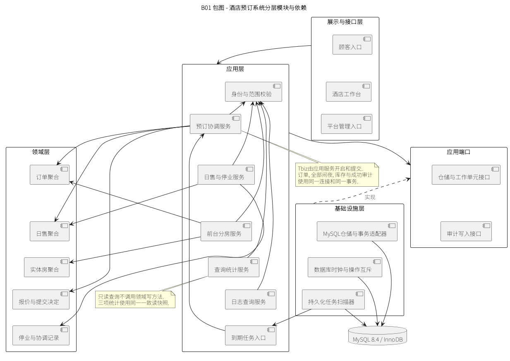
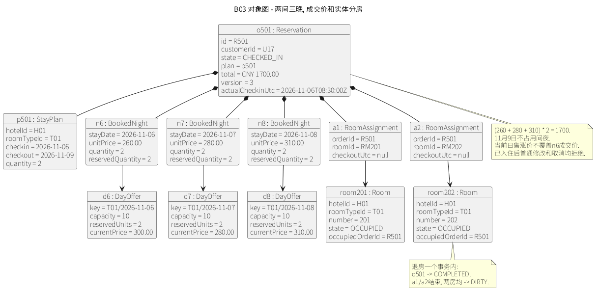
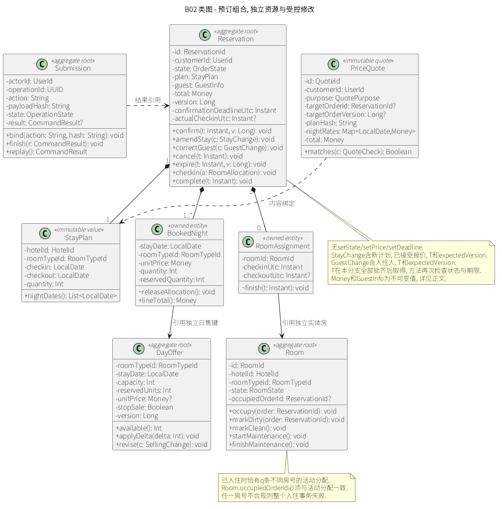
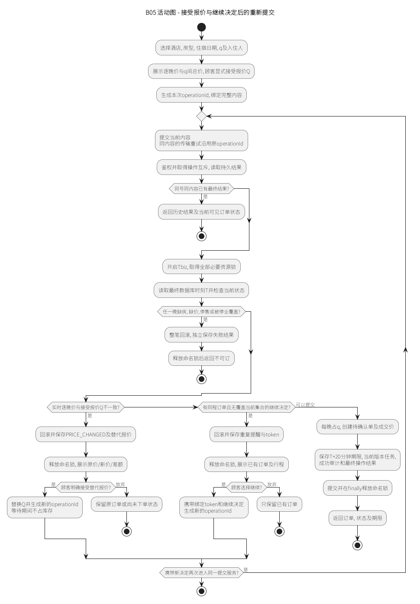
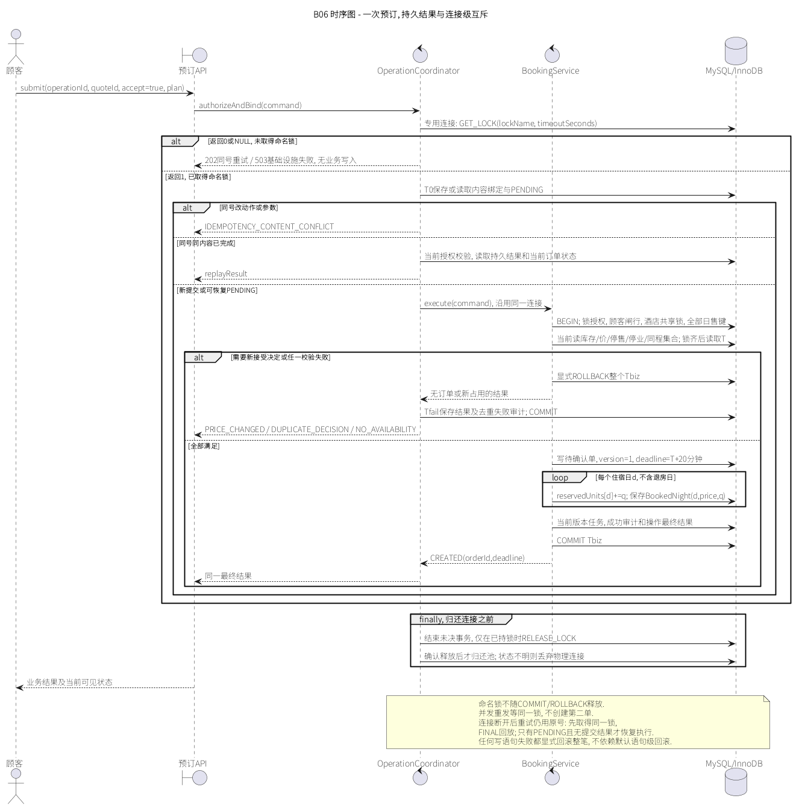
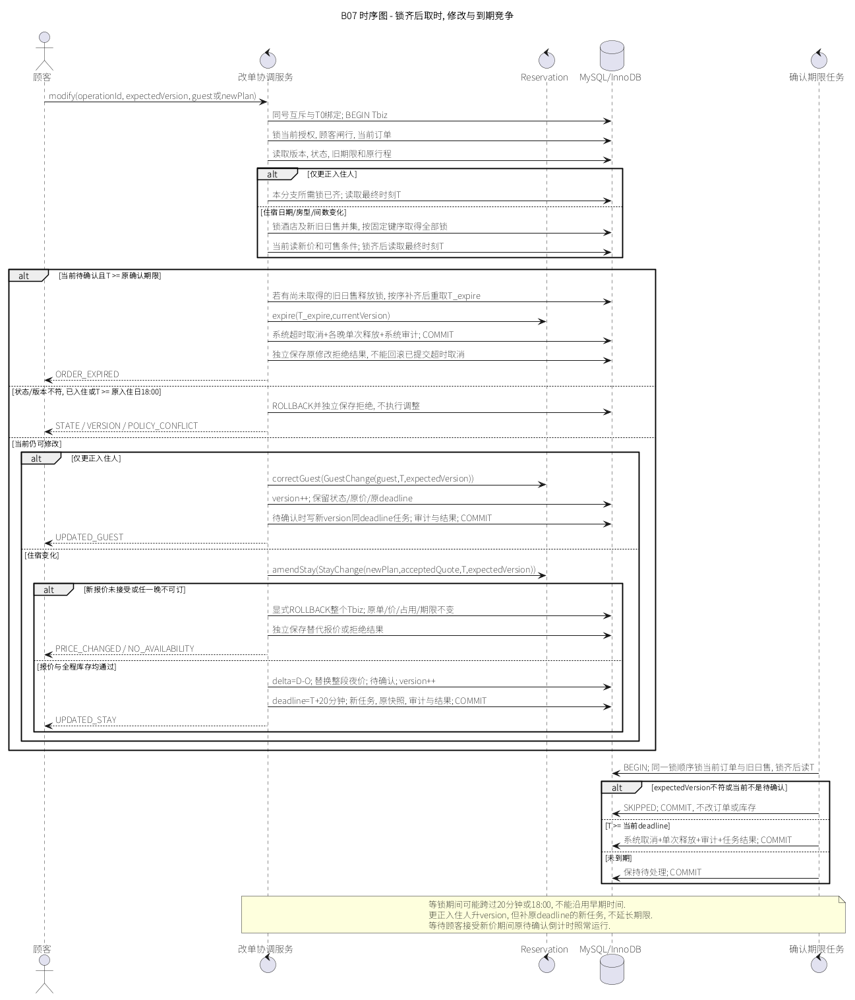
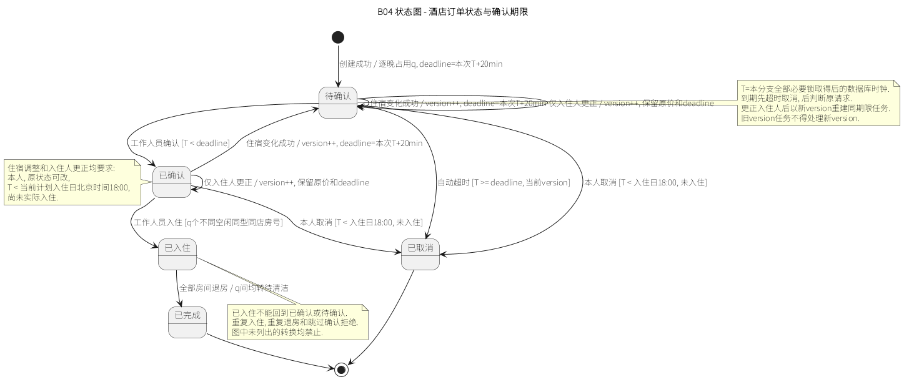
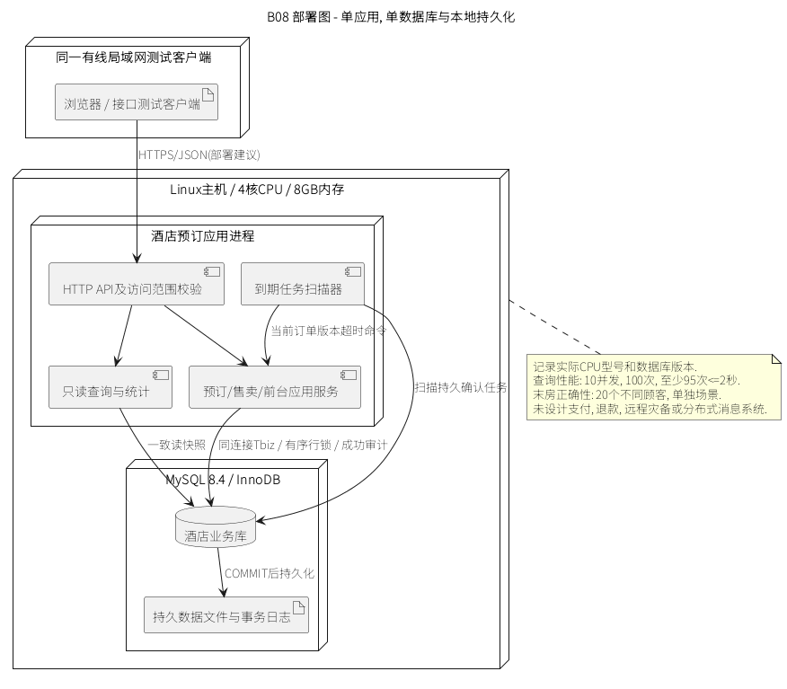

# 酒店预订系统设计

我选择的项目是酒店预订系统, 以实验一当前26条需求为基线. 一笔订单可以订同房型多间房, 所以需要同时看行程里的每一晚和预订间数. 我把本轮设计围绕三个问题展开: 顾客接受的是哪一份价格, 每晚的q间怎样整体占用, 到店后怎样分配q个不同房号. 本轮交付模型与界面方案, 后端的压力和故障测试留待实现后执行.

## 一笔订单涉及的对象

查房卖的是房型在住宿日期内的配额, 到店办理的才是实体客房. 两者分别保存状态: 待确认订单已经占每晚q间, 酒店确认不会再扣一次; 入住时才选具体房号. 退房将实体房转待清洁, 历史住宿日的成交和占用仍保留.

三类用户有不同入口. 顾客操作本人订单; 酒店工作人员维护授权酒店的日售并办理确认, 入住和退房; 管理员维护酒店与账号, 查看平台查询和统计. 工作人员的酒店维护权与日志查看权分开授予, 不能因为能处理订单就读取全部日志.

我采用单应用和MySQL/InnoDB. 接口层只整理请求, 应用服务安排锁与事务, 领域对象检查状态和金额等不变量, 仓储负责读写. 一次业务写事务覆盖订单, 全部住宿夜, 分房记录和成功日志. 这样三晚订单在第二晚失败时, 可以用一个本地事务恢复全部原值. 查房与统计走只读路径, 不直接调用领域写方法.

对象图先给一个可核算的例子: 11月6日入住, 9日退房, q=2, 三晚260/280/310元, 总价1700元. 9日不是住宿日. 订单已经入住, 对应两个不同房号201和202, 两房均归同一酒店和房型. 当日售价后来改为300元, 订单里的260元成交记录仍保留.

Reservation拥有StayPlan, 每晚成交记录和分房记录. DayOffer和Room是独立资源, 订单只引用其编号. PriceQuote不可变, Submission负责提交内容绑定和持久结果. 类图使用私有字段, 通过confirm, amendStay, correctGuest, expire等方法修改, 不给外部任意设置状态, 价格和期限的入口. 我把核心类图收在这条业务链上, 酒店资料与协调清单的完整字段留在数据设计中, 避免长跨包线把图撑得过散.

金额使用Decimal与明确的两位小数. 酒店住宿日使用北京时间DATE, 时刻以UTC Instant保存, 页面与日志日期转换为UTC+8. 数据库为同房型同日设置唯一键. 活动分房号使用可空生成列加唯一约束, 已退房历史仍可保留, 一个房号不能同时在两笔在住订单里出现. 恰好分q间的数量规则由领域方法和整笔事务校验.

## 报价接受和一次提交

价格范围在本轮明确为"每间每晚价格范围", 所选全部住宿夜都须满足. 查询结果另列q间全程总价. 人数匹配按人数不大于q乘单间上限, 这是写明的设计假设. 全程可售量取每晚余量的最小值, 不是各晚相加.

报价绑定顾客, 酒店房型, 起止日期, q, 每晚单价和总价. 下单时仍复核当前价格和库存. 如果例子的首晚从260改为300, 显示1700元与1780元及80元差额. 顾客接受前不新增占用; 接受后用新提交标识再次进入同一校验流程, 若价格再变就再次征询. 活动图把这个返回入口的循环画出来, 等待人的决定时已经结束数据库事务并释放命名锁.

同一个提交标识重发应返回同一订单结果. 另一个新标识提交相同行程, 则在待确认和已确认订单中比较酒店, 房型, 入住日, 退房日和间数五项, 只更换入住人仍需提醒. 提示展示旧订单, 顾客选择继续后携带绑定行程和已有订单集合的决定token, 使用新提交标识. 新增了尚未确认的同程订单时再提示, 放弃则保留原订单.

我保留原稿的持久操作记录方案. 一个专用数据库连接取得按调用者和operationId区分的命名锁, T0保存内容绑定, Tbiz保存成功业务及最终结果, 失败后Tfail另存拒绝记录. 命名锁跨这些事务, COMMIT和ROLLBACK都不会自动释放. finally要先结束未决事务, 显式释放锁, 才能归还连接池. 未取得锁时不执行预订, 连接中断后重试仍用原标识, 先查已存结果再决定能否恢复PENDING.

逐夜写入按固定键序获取锁. 任一写语句失败都显式回滚整个Tbiz, 不依赖数据库默认把某个失败语句当作整笔失败. 同顾客写操作还有提交闸行, 避免两个新请求同时绕过同程提醒. 不同顾客争抢最后一间时, 日售行锁和非负约束保护全程数量.

## 改住宿和只更正入住人

同房型改期按新旧逐夜占用的差额更新. 两间的6日至9日改为7日至10日, 差额是6日释放2间, 7/8日不变, 9日新增2间. 新增夜只有1间时整笔失败, 原行程, 价格, 占用和期限都保持. 新行程全部夜价重新报价, 包括重叠日期; 等待接受新价不会暂停原待确认倒计时.

这张图是我重点改过的一处. 原稿在锁新旧日售并集前就读取了最终时间, 等锁期间可能跨过20分钟或18:00. 我将最终取时移到本分支所有必要锁之后, 再检查当前版本, 旧期限和普通修改截止. 新确认期也从这次成功的业务时刻T起算. 过期待确认单先以系统超时事务取消, 原修改再拒绝, 不能把已提交的超时取消跟着拒绝一起回滚.

住宿日期, 房型或间数实际变化成功后回到待确认, 重新等待20分钟. 只更正入住人保留状态, 原价和旧期限. 原稿对此已有可行方案: 订单version递增, 同事务补新version对应的同旧deadline任务, 旧任务跳过, 当前待确认扫描兜底. 我保留了它. 10:00成功的订单在10:19:59可以确认, 到10:20:00仍待确认就取消. 普通修改和取消另受入住日北京时间18:00与实际入住的较早截止保护, 到18:00即停止, 不能拿酒店确认期替代这条政策.

## 到店办理和异常协调

订单按待确认, 已确认, 已入住, 已完成, 已取消办理. 已完成和已取消不恢复. 前台为一笔q间订单一次选q个不同的空闲同店同型房号, 任一房号重复, 已入住, 待清洁, 维修中或归属错误, 就整笔拒绝. 全部成功后才把订单和各房间转已入住. 退房同样一次结束全部活动分配, 各房间全部转待清洁, 清洁完成再恢复空闲.

停业或维修按酒店或房型的日期范围阻止新单. 原订单保留, 受影响清单按当前行程与停业范围交叠生成, 处理记录保存原因, 联系情况, 处理人和结果. 工作人员记录协调, 实际普通改单或取消仍按顾客本人权限和已有期限执行. 本轮没有增加前台越过截止强制改取消的入口.

成功审计和业务在同一事务. 失败尝试另存, attempted内容与实际已生效after值区分, 同操作编号不重复记录. 工作人员还要另有该酒店的VIEW_OPERATION_LOG权限才可查日志, 人员权限变更日志始终只给管理员, 授权撤销后下次请求重新校验.

## 管理列表和间夜统计的日期

管理列表使用当前计划入住日, 所选自然日两端包含. 5日下单但6日入住应纳入6日列表, 6日下单但7日入住应排除. 改到7日后立即按新入住日归属, 旧行程从审计追溯.

统计则先把含尾日范围[s,e]转为[s,e+1), 再与当前行程[ci,co)求交集. 只要有至少一晚交叠, 该订单就计预订数; 已取消也计预订和取消数, 有效间夜为0. 其他四种状态, 包括已完成, 以交叠晚数乘q累计. 三项指标来自同一条聚合或同一只读快照, 不额外计算已完成金额.

我独立计算了需求中的四组样例. 两间6日至9日的订单统计7至8日为1笔/0取消/4间夜; 取消后为1/1/0; 再加一间8日至10日的有效订单为2/1/1; 后一单改9日至11日后回到1/1/0. 计算记录在process/party-b-example-check.json, 这是文档样例核算.

## 界面的使用路径

顾客由UI-01进入, UI-02/03查多间连住, UI-04提交, UI-05处理变价, UI-22处理同程新请求. UI-06/07展示本人订单与确认期限, UI-08调整住宿, UI-09只更正入住人, UI-10取消. 售罄, 到期, 18点截止和他人订单反馈在UI-23.

酒店工作台通过UI-11处理确认, UI-12整体分配房号, UI-13整单退房, UI-14维护日售, UI-15维护实体房态, UI-16处理日期停业协调, UI-17维护房型. 平台使用UI-18酒店名录, UI-19账号与独立日志授权, UI-20经营查询. UI-21是获准后的日志检索, UI-24单独表示工作人员没有日志权限的拒绝, 不展示日志内容. 这24屏的图像与实际界面工具过程在界面章节列出, 此处只说明业务路径.

## 部署和验证安排

原型部署到4核CPU, 8GB内存的Linux主机, 应用和MySQL同机, 测试客户端经同一有线局域网访问. 查询数据是100家酒店, 300房型, 90天27000条日售和5000订单. 10用户各10次共100次组合查询, 至少95次正确且不超过2秒, 错误和超时都计失败. 20人抢最后一间是独立正确性场景. 重启检查已提交订单, 成交价和日志保留, 未提交写入不出现. 具体22个边界输入与设计落点列在boundary-cases.md, 26条追溯在traceability.md.

## 辅助工具的实际使用与取舍

首次通过Codex collaboration复用gpt-6.1-sol, reasoning_effort=xhigh, 将完整实验任务和26条需求交给同一助手. 调用消息, 完整输入和时间分别保存在process/party-b-ai-01-call.txt, party-b-ai-01-input.txt及时间记录中. 首次原稿57270字节, 包含8张7种UML, 与design/ai-01-proposal.md逐字节一致, 在内容修订前固定为lab2-uml-ai-draft. 原稿与原8图均保留.

初稿把逐夜差额, 报价内容绑定, 同程提醒和版本任务展开成了一套可对照的模型, 这些正确部分我保留了. 实际看图后, 我收紧了过散的类图, 补了StayPlan对象, 并把报价与继续决定画成真正返回提交的循环. 价格筛选原先假设整段总价, 在设计与界面口径确认后改为每间每晚. 等库存锁跨截止和连接归还前释放命名锁, 则需要对照时序和数据库语义才能确定.

第二次于2026-11-03 23:49:11 +08:00仍使用同一模型作只读检查, 输入含完整任务与26条需求, 当前设计, 追溯, 22个情境, 实际24屏索引和8图源, 共115843字节. 完整输入和回答保存在process/party-b-ai-02-input.txt及party-b-ai-02-output.md. 回答给出8项静态结论, 未提出阻断问题. 我逐项对照情境后保留业务规则, 再按实际渲染处理B01横向过宽, 并同步最新的UI-23/24分工. 这次检查覆盖的是输入快照, 最后仍要看渲染与真实界面, 数据库运行验收另行执行.

这次流程让我保留了两种不同的工作. 模型负责第一次完整展开和第二次交叉检查, 我负责定查询口径, 选择事务边界, 看实际渲染和逐个样例核对. 后续可以让生成, 渲染和追溯检查更自动化, 人仍要确认未定业务细节并决定如何处理新反馈. 只有检查清单而没有这些决定, 无法自动补出缺失的业务口径.
